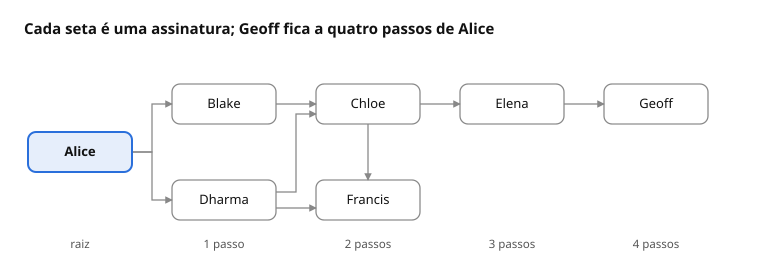

# Guia de Privacidade com GnuPG 2.4

Oct 23, 2026 • Daniel Dias Rodrigues

## Créditos e licença

Esta é uma versão modificada e atualizada de *The GNU Privacy Handbook* (em português, *Manual de Privacidade GNU*), revista para o GnuPG 2.4.

Copyright © 1999 The Free Software Foundation (documento original).

Copyright © 2026 Daniel Dias Rodrigues (versão modificada).

É concedida permissão para copiar, distribuir e/ou modificar este documento sob os termos da GNU Free Documentation License, Versão 1.3 ou qualquer versão posterior publicada pela Free Software Foundation; sem Seções Invariantes, sem Textos de Capa e sem Textos de Contracapa. Uma cópia da licença está incluída na seção intitulada "GNU Free Documentation License".

O documento original foi licenciado sob a GNU FDL, Versão 1.1 ou qualquer versão posterior. Esta versão modificada usa a faculdade dessa cláusula e adota a Versão 1.3.

Autores do documento original: Mike Ashley (mantenedor), Matthew Copeland, Joergen Grahn e David A. Wheeler. J Horacio MG traduziu o original para o espanhol. Autor e editor desta versão modificada: Daniel Dias Rodrigues. O original em inglês continua disponível em [gnupg.org/gph/en/manual.html](https://www.gnupg.org/gph/en/manual.html). As mudanças em relação a ele estão resumidas na seção "Histórico".

Convenções. Os exemplos de terminal mostram as mensagens do GnuPG em inglês, como aparecem num sistema configurado nesse idioma; em português o conteúdo é o mesmo, traduzido. Saídas longas foram encurtadas com `[...]`. Nomes, endereços e impressões digitais são fictícios. Termos adotados: *passphrase* = frase secreta; *keyring* = chaveiro; *fingerprint* = impressão digital; *web of trust* = rede de confiança; *keyserver* = servidor de chaves.

Sobre a versão. A série 2.4 deixou de receber correções do projeto GnuPG em 31 de dezembro de 2025, com a versão 2.4.9; o projeto FreePG e distribuições como o Debian continuam a manter a série. Os padrões descritos aqui (algoritmos, validade, servidor de chaves) são os do GnuPG 2.4.9; outras versões podem diferir.

## Capítulo 1. Primeiros passos

O GnuPG (GNU Privacy Guard) é a implementação do padrão OpenPGP feita pelo projeto GNU. Ele protege comunicações e arquivos de duas formas: criptografa dados para que só o destinatário os leia e assina dados para que qualquer pessoa confirme quem os produziu e que nada foi alterado. Este capítulo é um roteiro rápido das tarefas básicas: criar um par de chaves, trocar e conferir chaves, criptografar e descriptografar, e criar e verificar assinaturas. Os conceitos por trás disso estão no Capítulo 2; o uso criterioso, nos Capítulos 3 e 4.

O GnuPG usa criptografia de chave pública. Cada pessoa tem um par de chaves: uma *chave privada*, que fica só com ela, e uma *chave pública*, que pode ser entregue a qualquer pessoa com quem ela queira se comunicar. Na prática, o que o GnuPG chama de "chave" é um conjunto: uma chave primária, usada para assinar e para certificar outras chaves, e uma ou mais *subchaves* vinculadas a ela, cada uma com uma função, como criptografar. Junto com os IDs de usuário que identificam o dono, esse conjunto é tratado quase sempre como uma coisa só.

### Antes de começar

O GnuPG 2.4 é formado por alguns programas que trabalham juntos. O comando `gpg` cuida do OpenPGP. As chaves privadas ficam sob a guarda do `gpg-agent`, iniciado automaticamente, que pede a frase secreta numa pequena janela chamada *pinentry* e a mantém em memória por algum tempo. O acesso à rede, para buscar e publicar chaves, fica com o `dirmngr`. Tudo é guardado no diretório `~/.gnupg`: as chaves públicas no arquivo `pubring.kbx`, as privadas no diretório `private-keys-v1.d` e os dados de confiança em `trustdb.gpg`. O comando `gpg --version` mostra a versão instalada e os algoritmos disponíveis.

### Gerando um novo par de chaves

O comando mais simples é `gpg --generate-key` (ou `--gen-key`). Ele pede apenas nome e e-mail e usa os parâmetros padrão. Para escolher algoritmo e validade, use `--full-generate-key`:

```
alice$ gpg --full-generate-key
[...]
Please select what kind of key you want:
   (1) RSA and RSA
   (2) DSA and Elgamal
   (3) DSA (sign only)
   (4) RSA (sign only)
   (9) ECC (sign and encrypt) *default*
  (10) ECC (sign only)
  (14) Existing key from card
Your selection?
```

A opção padrão (9) usa criptografia de curvas elípticas e cria duas chaves: uma primária Ed25519, que assina e certifica, e uma subchave Cv25519 (também chamada X25519), que criptografa. Em seguida o programa pergunta a curva; aceite a Curve 25519, que é a padrão. Essas chaves são pequenas, rápidas e tão seguras quanto uma chave RSA de 3072 bits. A opção 1 (RSA) só se justifica se você precisar trocar mensagens com programas muito antigos; nesse caso, use pelo menos 3072 bits, que é o tamanho padrão. As opções com DSA e Elgamal são heranças do passado e não devem ser usadas em chaves novas. A opção 14 serve para cartões inteligentes, assunto do Capítulo 4.

Depois vem a validade. O programa aceita um número de dias, ou um número seguido de `w` (semanas), `m` (meses) ou `y` (anos); `0` significa que a chave não expira. Desde a versão 2.4.3, o padrão é de três anos. A expiração funciona como uma rede de segurança: se você perder o controle da chave e não tiver como revogá-la, ela deixa de valer sozinha. Ela não é definitiva, porque o dono da chave privada pode prorrogar a validade a qualquer momento, mesmo depois de vencida, como mostra o Capítulo 3. Por isso, ao contrário do que se recomendava em 1999, convém definir uma data de expiração.

Por fim, você informa o ID de usuário, que associa a chave a uma pessoa real:

```
GnuPG needs to construct a user ID to identify your key.

Real name: Alice
Email address: alice@example.org
Comment:
You selected this USER-ID:
    "Alice <alice@example.org>"

Change (N)ame, (C)omment, (E)mail or (O)kay/(Q)uit? O
```

O comentário é opcional e, em geral, fica melhor vazio. Um ID de usuário não pode ser editado depois de criado; se o e-mail mudar, você acrescenta um ID novo e revoga o antigo. É possível ter vários IDs na mesma chave, por exemplo um pessoal e um profissional.

Em seguida o *pinentry* pede a frase secreta que vai proteger a chave privada. Ela é a última barreira caso alguém copie seus arquivos, então merece cuidado. Uma frase longa formada por cinco ou seis palavras escolhidas ao acaso é mais forte e mais fácil de lembrar do que uma palavra curta cheia de símbolos. O Capítulo 4 volta a esse assunto.

Ao final, o GnuPG mostra o resultado:

```
gpg: revocation certificate stored as '/home/alice/.gnupg/openpgp-revocs.d/3F1C8A2E9B47D6051E3A7C9D4B21E8F05A6C92D3.rev'
public and secret key created and signed.

pub   ed25519 2026-10-23 [SC] [expires: 2029-10-22]
      3F1C8A2E9B47D6051E3A7C9D4B21E8F05A6C92D3
uid                      Alice <alice@example.org>
sub   cv25519 2026-10-23 [E] [expires: 2029-10-22]
```

A linha `pub` é a chave primária e a linha `sub`, a subchave. As letras entre colchetes indicam o que cada uma faz: `S` assina, `C` certifica outras chaves, `E` criptografa e `A` autentica. A sequência de 40 caracteres hexadecimais é a *impressão digital* da chave, que a identifica de forma única. Os últimos 16 caracteres formam o *ID longo* da chave (`4B21E8F05A6C92D3`). Evite o antigo ID curto, de 8 caracteres: hoje é fácil fabricar uma chave falsa com o mesmo ID curto de outra. Sempre que possível, identifique chaves pela impressão digital completa.

#### Guardando o certificado de revogação

Repare na primeira linha da saída. O GnuPG já gerou um *certificado de revogação* e o guardou no diretório `openpgp-revocs.d`. Se você esquecer a frase secreta, ou se a chave privada for perdida ou roubada, esse certificado permite avisar a todos que a chave pública não deve mais ser usada. Uma chave revogada ainda serve para verificar assinaturas antigas, mas ninguém deve criptografar mensagens novas para ela. A revogação não impede você de descriptografar mensagens antigas, desde que ainda tenha a chave privada.

Copie esse arquivo para um lugar seguro fora do computador, como um pendrive guardado ou uma folha impressa. Ele precisa ficar longe do alcance de outras pessoas, porque quem o tiver pode revogar sua chave. Para evitar uso acidental, o GnuPG insere dois-pontos no início da linha `-----BEGIN PGP PUBLIC KEY BLOCK-----`; para usar o certificado, você apaga esse caractere e importa o arquivo (veja o Capítulo 3). Também é possível gerar um certificado novo, indicando o motivo da revogação:

```
alice$ gpg --output revoke.asc --generate-revocation alice@example.org
```

O argumento `alice@example.org` é um *especificador de chave*: pode ser a impressão digital, o ID longo, o e-mail ou qualquer parte do ID de usuário que identifique a chave sem ambiguidade.

### Trocando chaves

Para se comunicar com outras pessoas, vocês precisam trocar chaves públicas. A opção `--list-keys` (ou `-k`) lista as chaves do seu chaveiro:

```
alice$ gpg --list-keys
/home/alice/.gnupg/pubring.kbx
------------------------------
pub   ed25519 2026-10-23 [SC] [expires: 2029-10-22]
      3F1C8A2E9B47D6051E3A7C9D4B21E8F05A6C92D3
uid           [ultimate] Alice <alice@example.org>
sub   cv25519 2026-10-23 [E] [expires: 2029-10-22]
```

A indicação `[ultimate]` mostra que o GnuPG confia plenamente nessa chave, porque ela é sua. A opção `--list-secret-keys` (ou `-K`) lista as chaves para as quais você tem a parte privada.

#### Exportando uma chave pública

Para enviar sua chave pública a alguém, exporte-a com `--export`, indicando qual chave exportar. Por padrão a saída é binária, o que atrapalha quem quer colar a chave num e-mail ou numa página web. A opção `--armor` (ou `-a`) gera a saída em *armadura ASCII*, isto é, em texto puro. Ela vale para qualquer saída do GnuPG: chaves, mensagens criptografadas e assinaturas.

```
alice$ gpg --armor --output alice.asc --export alice@example.org
alice$ cat alice.asc
-----BEGIN PGP PUBLIC KEY BLOCK-----

mDMEaRqC4BYJKwYBBAHaRw8BAQdA[...]
-----END PGP PUBLIC KEY BLOCK-----
```

#### Importando uma chave pública

Uma chave recebida é adicionada ao chaveiro com `--import`:

```
alice$ gpg --import blake.asc
gpg: key E4F60718293A4B5C: public key "Blake <blake@example.org>" imported
gpg: Total number processed: 1
gpg:               imported: 1
```

Importar não basta: falta *validar* a chave, ou seja, ter certeza de que ela pertence mesmo a Blake e não a alguém se passando por ele. O GnuPG tem um modelo de confiança flexível que dispensa validar pessoalmente cada chave, como se verá no Capítulo 3. Algumas chaves, porém, você mesmo precisa validar. Isso é feito conferindo a impressão digital e, depois, assinando a chave para certificá-la. A opção `--fingerprint` mostra a impressão digital em grupos fáceis de ler em voz alta:

```
alice$ gpg --fingerprint blake@example.org
pub   ed25519 2026-09-14 [SC] [expires: 2029-09-13]
      7A9B 2C4D 1E6F 8031 A5B7  C9D2 E4F6 0718 293A 4B5C
uid           [ unknown] Blake <blake@example.org>
sub   cv25519 2026-09-14 [E] [expires: 2029-09-13]
```

Compare essa sequência com a que Blake lhe passar por outro meio: pessoalmente, por telefone, num cartão de visita ou em qualquer canal no qual você tenha certeza de estar falando com ele. Se forem iguais, a cópia da chave está correta. Como a verificação de chaves é um ponto fraco da criptografia de chave pública, nunca assine uma chave sem *antes* conferir a impressão digital com o dono.

Conferida a impressão digital, assine a chave:

```
alice$ gpg --sign-key blake@example.org
[...]
Are you sure that you want to sign this key with your
key "Alice <alice@example.org>" (4B21E8F05A6C92D3)

Really sign? (y/N) y
```

Se você quiser certificar a chave só para seu próprio uso, sem que a assinatura seja exportada, use `--lsign-key`. Para ver as assinaturas de uma chave e conferir se são válidas, use `--check-sigs`:

```
alice$ gpg --check-sigs blake@example.org
pub   ed25519 2026-09-14 [SC] [expires: 2029-09-13]
      7A9B2C4D1E6F8031A5B7C9D2E4F60718293A4B5C
uid           [  full  ] Blake <blake@example.org>
sig!3        E4F60718293A4B5C 2026-09-14  [self-signature]
sig!         4B21E8F05A6C92D3 2026-10-23  Alice <alice@example.org>
sub   cv25519 2026-09-14 [E] [expires: 2029-09-13]
sig!         E4F60718293A4B5C 2026-09-14  [self-signature]
```

Cada ID de usuário tem uma *autoassinatura*, feita pelo próprio dono, e uma assinatura de cada pessoa que validou a chave. O ponto de exclamação indica assinatura verificada. A validade de Blake passou de `[ unknown]` para `[  full  ]`.

### Criptografando e descriptografando documentos

As chaves pública e privada têm papéis diferentes. Pense na chave pública como um cadeado aberto que você distribui à vontade. Quem quer lhe mandar um documento põe o documento numa caixa e fecha o cadeado. Depois de fechado, só a sua chave privada abre o cadeado. Assim, para mandar uma mensagem a Blake, Alice usa a chave pública dele, e Blake a abre com a chave privada dele. No sentido contrário, Blake usa a chave pública de Alice.

Para criptografar, use `--encrypt` (ou `-e`) e indique cada destinatário com `--recipient` (ou `-r`). O documento a criptografar é a entrada; sem nome de arquivo, o GnuPG lê a entrada padrão. O resultado vai para a saída padrão ou para o arquivo indicado com `--output` (ou `-o`). Antes de criptografar, o GnuPG compacta os dados, a menos que já estejam compactados.

```
alice$ gpg --output doc.gpg --encrypt --recipient blake@example.org doc
```

Só quem tiver a chave privada de um dos destinatários consegue ler o resultado. Isso inclui você: um documento que você mesmo criptografou fica ilegível para você, a menos que você se inclua entre os destinatários. Para que isso aconteça sempre, coloque a linha `encrypt-to` seguida da sua impressão digital no arquivo `~/.gnupg/gpg.conf`.

Para descriptografar, use `--decrypt` (ou `-d`). Você precisa da chave privada correspondente; o *pinentry* pede a frase secreta, se ela não estiver em memória.

```
blake$ gpg --output doc --decrypt doc.gpg
gpg: encrypted with cv25519 key, ID 5C1D9E3F7A0B2468, created 2026-09-14
      "Blake <blake@example.org>"
```

Também é possível criptografar sem chaves públicas, usando apenas uma *cifra simétrica*. A chave da cifra é derivada de uma frase secreta informada na hora, que não deve ser a mesma da sua chave privada. É útil para proteger seus próprios arquivos ou quando a frase secreta pode ser combinada com o destinatário. Use `--symmetric` (ou `-c`):

```
alice$ gpg --output doc.gpg --symmetric doc
```

O `gpg-agent` guarda essa frase em memória por algum tempo, o que facilita descriptografar logo em seguida. Se não quiser isso, use também `--no-symkey-cache`.

### Criando e verificando assinaturas

Uma assinatura digital certifica um documento e registra a data e a hora em que foi feita. Se o documento mudar depois disso, mesmo em um único caractere, a verificação falha. A assinatura digital cumpre o papel da assinatura de próprio punho, com a vantagem de denunciar adulterações. Os índices dos repositórios do Debian, por exemplo, e o próprio código-fonte do GnuPG são distribuídos com assinaturas, para que qualquer pessoa confirme que ninguém os alterou no caminho.

Assinar usa o par de chaves de modo inverso ao da criptografia. A assinatura é feita com a chave *privada* de quem assina e verificada com a chave *pública* correspondente. Se Alice assina um contrato e o envia, qualquer pessoa com a chave pública dela confirma que o documento veio dela e não foi alterado. Daí uma consequência importante: é difícil negar uma assinatura feita com sua chave, pois isso implicaria admitir que sua chave privada foi comprometida.

Para assinar, use `--sign` (ou `-s`). O documento assinado é compactado e gravado em formato binário.

```
alice$ gpg --output doc.sig --sign doc
```

Para apenas verificar a assinatura, use `--verify`. Para verificar e também recuperar o documento original, use `--decrypt`:

```
blake$ gpg --output doc --decrypt doc.sig
gpg: Signature made Fri 23 Oct 2026 10:15:02 AM -03
gpg:                using EDDSA key 3F1C8A2E9B47D6051E3A7C9D4B21E8F05A6C92D3
gpg: Good signature from "Alice <alice@example.org>" [full]
```

O `[full]` no final indica que a chave de Alice é válida para Blake. Se aparecer `[unknown]` e um aviso de que a chave não está certificada, a assinatura confere com a chave, mas nada garante que a chave seja de quem diz ser.

As opções `--sign` e `--encrypt` podem ser combinadas para assinar e criptografar de uma vez. Ao descriptografar, o GnuPG verifica a assinatura automaticamente.

#### Assinaturas em texto claro

Às vezes o documento precisa continuar legível sem o GnuPG, como numa mensagem enviada a uma lista de discussão. A opção `--clear-sign` (ou `--clearsign`) envolve o texto numa assinatura em armadura ASCII, sem alterá-lo de outra forma:

```
alice$ gpg --clear-sign doc
alice$ cat doc.asc
-----BEGIN PGP SIGNED MESSAGE-----
Hash: SHA512

[...]
-----BEGIN PGP SIGNATURE-----

iHUEARYKAB0WIQQ/HIoum0fWBR46fJ1LIejwWmyS0wUC[...]
-----END PGP SIGNATURE-----
```

Esse formato tem armadilhas. Espaços no fim das linhas podem ser alterados, e cabeçalhos e textos fora do bloco assinado não são protegidos. No fim de 2025, pesquisadores mostraram falhas práticas na forma como programas OpenPGP, inclusive o GnuPG, interpretavam esse formato; parte das correções veio na versão 2.4.9. O próprio manual do GnuPG recomenda preferir assinaturas destacadas. Se for verificar um texto assinado assim, use `--output` para extrair o que de fato foi assinado e leia essa versão.

#### Assinaturas destacadas

Um documento assinado com `--sign` precisa ser processado para recuperar o original, e o texto claro também mistura assinatura e conteúdo. A terceira forma resolve isso: a *assinatura destacada* fica num arquivo separado, e o documento não é alterado. É a forma usada para assinar pacotes de software, imagens de instalação e arquivos em geral. Crie-a com `--detach-sign` (ou `-b`):

```
alice$ gpg --armor --detach-sign doc
```

O comando gera o arquivo `doc.asc`. Para verificar, informe sempre os dois arquivos, primeiro a assinatura e depois o documento:

```
blake$ gpg --verify doc.asc doc
gpg: Signature made Fri 23 Oct 2026 10:38:46 AM -03
gpg:                using EDDSA key 3F1C8A2E9B47D6051E3A7C9D4B21E8F05A6C92D3
gpg: Good signature from "Alice <alice@example.org>" [full]
```

Em scripts, não confie só no código de saída do `gpg`. Use o programa `gpgv`, feito para verificar assinaturas contra uma lista fixa de chaves confiáveis, ou a opção `--assert-signer` seguida da impressão digital esperada. Com ela, o `gpg` só termina com sucesso se houver uma assinatura válida daquela chave.

## Capítulo 2. Conceitos

O GnuPG combina três ferramentas da criptografia: *cifras simétricas*, *cifras de chave pública* e *funções de hash*. Dá para usar o programa no básico sem conhecê-las a fundo, mas usá-lo com critério exige alguma noção de como funcionam.

Este capítulo apresenta esses conceitos de forma resumida. Para ir além, *Applied Cryptography*, de Bruce Schneier, continua a ser um clássico, embora sua última edição seja de 1996; *Serious Cryptography*, de Jean-Philippe Aumasson, é uma introdução mais recente.

### Cifras simétricas

Uma cifra simétrica usa a mesma chave para criptografar e para descriptografar. As duas partes precisam combinar a chave antes. Feito isso, o remetente criptografa com ela e o destinatário descriptografa com ela. A máquina Enigma, usada pela Alemanha na Segunda Guerra Mundial, era uma cifra simétrica: as chaves de cada dia vinham num livro de códigos, e os operadores de rádio dos dois lados consultavam suas cópias para ajustar as máquinas. Hoje, a cifra simétrica mais usada é o AES, padrão do governo dos EUA desde 2001. O GnuPG também oferece Camellia e Twofish. Cifras mais antigas, como 3DES, CAST5, Blowfish e IDEA, ficaram para trás e não são usadas em mensagens novas.

Numa boa cifra, toda a segurança está na chave e nenhuma no algoritmo. Saber qual cifra foi usada não deve ajudar em nada quem quer quebrá-la; o algoritmo pode ser público. As cifras do GnuPG têm essa propriedade.

Se toda a segurança está na chave, a chave tem de ser difícil de adivinhar. Em outras palavras, o conjunto de chaves possíveis, chamado *espaço de chaves*, precisa ser enorme. Richard Feynman ficou famoso em Los Alamos por abrir cofres. Ele não tinha poderes especiais: usava truques para reduzir as combinações possíveis a umas poucas e então testava uma a uma. Ou seja, encolhia o espaço de chaves. Na mesma guerra, os britânicos construíram máquinas eletromecânicas, as Bombes, para testar chaves da Enigma em série até achar a do dia. Às vezes conseguiam em poucas horas, às vezes nunca. As Bombes foram precursoras dos computadores.

Computadores testam chaves muito depressa, e por isso o tamanho da chave importa tanto. O DES, padrão nos anos 1970, usava chaves de 56 bits, cerca de 72 quatrilhões de possibilidades. Em 1998, uma máquina construída pela Electronic Frontier Foundation encontrou uma chave DES em menos de três dias; hoje isso é trivial. O AES usa chaves de 128 ou 256 bits. Com 128 bits, há 2^128 chaves; mesmo que todos os computadores do planeta trabalhassem juntos, testar todas levaria muito mais que a idade do universo.

### Cifras de chave pública

O grande problema das cifras simétricas não é a segurança, mas a troca de chaves. Depois de combinada, a chave permite comunicação segura, mas por qual canal seguro ela foi combinada? Provavelmente é muito mais fácil para um atacante interceptar a chave do que testar todo o espaço de chaves. Há ainda o problema da quantidade: se *n* pessoas querem conversar duas a duas em sigilo, são necessárias *n(n-1)/2* chaves. Funciona para poucas pessoas, mas não escala.

As cifras de chave pública foram inventadas para eliminar esse problema. Elas usam um par de chaves, e as duas pertencem a quem *recebe* as mensagens. Uma é a *chave pública*, que pode ser entregue a qualquer pessoa. A outra é a *chave privada*, que o dono guarda em segredo. O remetente criptografa com a chave pública, e só a chave privada consegue descriptografar.

Com isso, ninguém precisa combinar uma chave secreta. Basta que o remetente obtenha, antes de escrever, uma cópia da chave pública do destinatário. E a mesma chave pública serve para qualquer pessoa que queira escrever àquele destinatário. Assim, *n* pares de chaves bastam para que *n* pessoas se comuniquem em sigilo.

As cifras de chave pública se baseiam em funções *de mão única com alçapão* (*trapdoor*). Uma função de mão única é fácil de calcular e difícil de inverter. Multiplicar dois números primos grandes é fácil; descobrir esses primos a partir do produto é muito difícil. O "alçapão" é uma informação que torna a inversão fácil para quem a conhece. No RSA, a chave pública contém o produto de dois primos grandes, e a chave privada contém os próprios primos. Quem tem a chave privada descriptografa com facilidade; quem não tem precisaria fatorar o produto.

As chaves padrão do GnuPG 2.4 usam outro problema matemático, o do logaritmo discreto em curvas elípticas. A ideia é a mesma, mas as chaves são muito menores para o mesmo nível de segurança. Por isso não se pode comparar tamanhos de chave entre famílias diferentes. Num ataque de força bruta a uma cifra simétrica de 128 bits, o atacante testa até 2^128 chaves; contra o RSA, ele precisa fatorar um número enorme; contra curvas elípticas, resolver outro problema. A tabela abaixo, baseada na publicação SP 800-57 do NIST, mostra tamanhos de chave que oferecem segurança equivalente:

| Segurança (bits) | Cifra simétrica | RSA (bits) | Curva elíptica (bits) |
| --- | --- | --- | --- |
| 112 | 3DES | 2048 | 224 |
| 128 | AES-128 | 3072 | 256 (como a Curve25519) |
| 192 | AES-192 | 7680 | 384 |
| 256 | AES-256 | 15360 | 512 |

Há uma ameaça no horizonte. Um computador quântico suficientemente grande, rodando o algoritmo de Shor, quebraria tanto o RSA quanto as curvas elípticas. Esse computador ainda não existe, mas alguém pode guardar hoje mensagens criptografadas para ler no futuro. Por isso surgiram algoritmos chamados pós-quânticos. O GnuPG 2.4 não os oferece; a série 2.5 passou a incluir o ML-KEM, também conhecido como Kyber. Para as cifras simétricas, o risco quântico é menor: chaves de 256 bits mantêm boa margem.

### Cifras híbridas

Cifras de chave pública não resolvem tudo. As simétricas são muito mais rápidas e, para o mesmo tamanho de chave, mais fortes. Em compensação, as de chave pública são ótimas para distribuir chaves simétricas. É assim que funcionam as cifras híbridas.

Uma cifra híbrida usa as duas. O programa sorteia uma chave simétrica nova, a *chave de sessão*, e criptografa a mensagem com ela. Depois criptografa a chave de sessão com a chave pública de cada destinatário e junta tudo num só pacote. O destinatário usa sua chave privada para recuperar a chave de sessão e, com ela, lê a mensagem. Como cada mensagem tem sua própria chave de sessão, quem conseguisse quebrar uma delas leria só aquela mensagem.

O GnuPG usa cifras híbridas. Uma cifra híbrida não é mais forte que a mais fraca de suas partes; em geral, o alvo mais provável é a parte de chave pública, ou a própria chave privada no computador do usuário.

Além do sigilo, hoje se exige *integridade*: o destinatário precisa saber se alguém alterou a mensagem no caminho. As mensagens OpenPGP de 1999 não tinham essa proteção. Desde 2018, com a versão 2.2.8, o GnuPG trata como erro grave uma mensagem sem verificação de integridade. O GnuPG 2.4 sabe usar o modo OCB, que cifra e autentica ao mesmo tempo, quando todas as chaves dos destinatários declaram suportá-lo. Esse modo segue a especificação LibrePGP, adotada pelo GnuPG, e não o padrão RFC 9580, publicado pela IETF em 2024 e adotado por outros programas, como o Sequoia. Por isso, mensagens em modo OCB podem não ser lidas por outros programas OpenPGP. O pacote do Debian altera o GnuPG para não anunciar nem usar esse modo. Se você usar outra distribuição e alguém não conseguir ler suas mensagens, essa é uma causa provável.

### Assinaturas digitais

Uma *função de hash* transforma uma entrada de qualquer tamanho num valor de tamanho fixo. Uma função de hash simples é *f*(*x*) = 0 para todo inteiro *x*. Uma mais interessante é *f*(*x*) = *x* *mod* 37, que devolve o resto da divisão de *x* por 37.

Uma assinatura digital parte do hash do documento. Para isso servir, a função precisa ter duas propriedades. Primeiro, deve ser inviável achar dois documentos com o mesmo hash, o que se chama *colisão*. Segundo, dado um hash, deve ser inviável produzir um documento que o gere. Nenhuma das duas funções acima serve. As funções usadas na prática foram projetadas para isso, como as da família SHA-2 (SHA-256 e SHA-512). Funções mais antigas falharam. O MD5 caiu nos anos 2000. Em 2017 foi publicada a primeira colisão prática do SHA-1, e em 2020 pesquisadores forjaram assinaturas de chaves OpenPGP com uma colisão de SHA-1. Desde a versão 2.2.18, o GnuPG rejeita certificações de chave com SHA-1 feitas depois de 19 de janeiro de 2019, e a 2.4.9 fechou uma brecha que permitia rebaixar certificações para SHA-1.

Na teoria, algumas cifras de chave pública poderiam assinar o documento inteiro: quem assina o "criptografa" com sua chave privada, e qualquer um o confere com a chave pública. Na prática isso é lento demais. A solução é calcular o hash do documento e aplicar o algoritmo de assinatura, com a chave privada, apenas ao hash. Quem verifica calcula o hash da sua cópia e confere, com a chave pública, se ele corresponde à assinatura. Se o documento tiver sido alterado, os hashes não batem e a verificação falha. O documento em si pode viajar criptografado ou não; a assinatura protege a integridade e a autoria, não o sigilo.

Seria um erro tentar obter as duas coisas criptografando documento e assinatura com uma cifra híbrida "ao contrário", usando a chave privada de quem assina. Nesse caso, a chave de sessão poderia ser recuperada por qualquer pessoa com a chave pública, e um atacante a usaria para forjar documentos e assinaturas. Assinatura e criptografia são operações separadas, e o GnuPG as combina na ordem certa quando você usa `--sign` e `--encrypt` juntos.

Em 1999, o algoritmo de assinatura padrão do GnuPG era o DSA. Hoje é o EdDSA com a curva Ed25519. Ele é rápido, gera assinaturas pequenas e não depende de um número aleatório novo a cada assinatura, o que elimina um tipo de falha que já vazou chaves privadas DSA e ECDSA na prática. O RSA também continua disponível.

## Capítulo 3. Gerenciamento de chaves

A adulteração de chaves é uma fraqueza séria da criptografia de chave pública. Um bisbilhoteiro pode mexer no chaveiro de alguém, ou forjar a chave pública de outra pessoa e publicá-la para que seja baixada e usada. Suponha que Chloe queira ler as mensagens que Alice manda para Blake. Ela pode montar o ataque chamado *homem no meio* (*man-in-the-middle*): cria um par de chaves novo e troca a cópia da chave de Blake que Alice tem pela sua chave pública falsa. Depois intercepta as mensagens de Alice, descriptografa cada uma com a chave privada falsa, criptografa de novo com a chave verdadeira de Blake e a repassa. Blake recebe tudo normalmente, e Chloe lê tudo.

Um bom gerenciamento de chaves protege a integridade do seu chaveiro e dos chaveiros dos outros. No GnuPG, ele gira em torno de assinar chaves. Assinar uma chave tem dois propósitos: detectar adulterações e certificar que a chave pertence a quem o ID de usuário diz. As assinaturas de chaves também sustentam a *rede de confiança*, que estende a validação a chaves que você não assinou, mas que foram assinadas por pessoas em quem você confia. Usuários cuidadosos tornam a adulteração de chaves um ataque pouco prático.

### Gerenciando seu próprio par de chaves

A parte pública de uma chave é formada pela parte pública da chave primária, pelas partes públicas das subchaves e pelos IDs de usuário, que associam a chave a uma pessoa real. Cada componente traz dados sobre si. Uma chave registra seu ID, data de criação, data de expiração e funções. Um ID de usuário registra nome, comentário opcional e e-mail. As partes privadas ficam guardadas à parte, sob controle do `gpg-agent`.

O comando `--edit-key` abre um menu interativo com tudo isso:

```
chloe$ gpg --edit-key chloe@example.org
Secret key is available.

sec  ed25519/3C4D5E6F708192A3
     created: 2026-06-15  expires: 2029-06-14  usage: SC
     trust: ultimate      validity: ultimate
ssb  cv25519/9A8B7C6D5E4F3021
     created: 2026-06-15  expires: 2029-06-14  usage: E
ssb  ed25519/1F2E3D4C5B6A7980
     created: 2026-06-15  expires: 2027-06-15  usage: S
[ultimate] (1). Chloe (Jester) <chloe@example.org>
[ultimate] (2)  Chloe (Plebeian) <chloe@example.net>

gpg>
```

A mensagem `Secret key is available` indica que a parte privada está disponível. Por isso a chave primária aparece como `sec` e as subchaves como `ssb`; sem a parte privada, apareceriam como `pub` e `sub`. Cada linha mostra o algoritmo, o ID da chave, as datas e as funções (`usage`). Os IDs de usuário vêm por último, numerados; o ponto depois do número marca o ID principal. No GnuPG de 1999 havia um comando `toggle` para alternar entre as partes pública e privada; hoje ele não faz nada. Fora do menu, `--list-secret-keys` mostra `sec#` quando a parte privada da chave primária não está no computador e `sec>` quando está num cartão inteligente.

#### Integridade da chave

Ao distribuir sua chave pública, você distribui as partes públicas da chave primária e das subchaves, mais os IDs de usuário. Se fosse só isso, um atacante poderia alterar a chave: trocar o e-mail de um ID para receber as mensagens no seu lugar, ou trocar a subchave de criptografia por uma dele para lê-las.

As assinaturas digitais resolvem isso. Dados assinados com uma chave privada ficam vinculados à chave pública correspondente: só ela verifica a assinatura, e qualquer alteração a invalida. Por isso a chave primária assina cada ID de usuário e cada subchave da própria chave. A assinatura de um ID pela chave primária do mesmo dono é a *autoassinatura*. As subchaves de assinatura, além disso, assinam de volta a chave primária, o que impede um atacante de anexá-las a outra chave. O conjunto da chave pública com suas autoassinaturas é o *certificado*. O comando `check` mostra as autoassinaturas:

```
gpg> check
uid  Chloe (Jester) <chloe@example.org>
sig!3        3C4D5E6F708192A3 2026-06-15  [self-signature]
uid  Chloe (Plebeian) <chloe@example.net>
sig!3        3C4D5E6F708192A3 2026-06-15  [self-signature]
```

#### Adicionando e excluindo componentes

Novos IDs de usuário e subchaves podem ser acrescentados a qualquer momento. No menu de edição, `adduid` pede nome, e-mail e comentário, como na criação da chave, e `addkey` cria uma subchave, perguntando algoritmo, função e validade. Há também atalhos de linha de comando:

```
chloe$ gpg --quick-add-uid chloe@example.org "Chloe <chloe@trabalho.example>"
chloe$ gpg --quick-add-key C2D4E6F80A1B3C5D7E9F1A2B3C4D5E6F708192A3 ed25519 sign 1y
```

Os novos componentes são autoassinados com a chave primária, por isso o *pinentry* pede a frase secreta.

IDs adicionais servem quando você tem várias identidades, como uma profissional e outra ligada a uma associação ou causa. Os colegas de trabalho conhecem um endereço; os companheiros de militância, outro. Como esses grupos talvez não se conheçam, cada um pode não confiar no ID do outro, e por isso os dois são úteis.

Subchaves adicionais também são úteis. Os IDs de usuário ligados à chave primária são validados pelas pessoas com quem você se comunica, e trocar a chave primária exige refazer todas essas certificações. Já as subchaves podem ser trocadas sem esse custo. Se uma subchave de criptografia for quebrada, só os dados criptografados para ela ficam expostos; trocá-la de tempos em tempos limita o estrago. Uma subchave de assinatura permite guardar a chave primária fora do computador, como mostra o Capítulo 4, e uma subchave de autenticação (`auth`) serve para o SSH, assunto do Capítulo 5.

Para excluir um ID ou uma subchave, selecione-o com `uid n` ou `key n` e use `deluid` ou `delkey`. Esses comandos de seleção funcionam como interruptores: `key 2` marca a segunda subchave, e repetir o comando a desmarca; `key 0` desmarca todas. Excluir, porém, raramente é a escolha certa para a sua própria chave. Quando alguém importa uma versão nova da sua chave, o GnuPG a mescla com a cópia antiga, e os componentes que você apagou voltam. Os servidores de chaves fazem o mesmo e nunca apagam nada. Para retirar um componente da sua chave, revogue-o. A exclusão é útil para limpar chaves de outras pessoas no seu chaveiro; os comandos `clean` e `minimize` fazem isso automaticamente.

#### Revogando componentes

Para revogar uma subchave, selecione-a e use `revkey`. O GnuPG pede o motivo e acrescenta uma assinatura de revogação, que vale imediatamente:

```
gpg> key 2
[...]
gpg> revkey
Do you really want to revoke this subkey? (y/N) y
Please select the reason for the revocation:
  0 = No reason specified
  1 = Key has been compromised
  2 = Key is superseded
  3 = Key is no longer used
  Q = Cancel
Your decision? 2
[...]
gpg> save
```

Um ID de usuário é revogado com `revuid`, no menu, ou com `--quick-revoke-uid`, na linha de comando. Na teoria, um ID descreve a mesma pessoa para sempre, mas na prática o e-mail e o comentário mudam com o tempo, e o ID antigo deixa de valer. Como os correspondentes só confiam em IDs com autoassinatura válida, um ID revogado deixa de ser usado. Para retirar uma assinatura que você fez na chave de outra pessoa, use `revsig` ou `--quick-revoke-sig`.

Para revogar a chave inteira, importe o certificado de revogação descrito no Capítulo 1, lembrando de apagar antes os dois-pontos que o protegem:

```
alice$ gpg --import revoke.asc
gpg: key 4B21E8F05A6C92D3: "Alice <alice@example.org>" revocation certificate imported
[...]
```

Depois distribua a chave revogada, exportando-a ou enviando-a ao servidor de chaves. Revogar acrescenta assinaturas e não apaga nada. Por isso, quando sua chave atualizada for mesclada com cópias antigas, a revogação sempre aparece, e todos acabam com uma visão coerente da sua chave.

#### Atualizando a data de expiração

A validade de uma chave é alterada com o comando `expire` do menu de edição. Sem subchave selecionada, ele muda a validade da chave primária; com uma selecionada, a dela. O atalho de linha de comando é `--quick-set-expire`; com um asterisco no final, ele muda a validade de todas as subchaves válidas:

```
alice$ gpg --quick-set-expire 3F1C8A2E9B47D6051E3A7C9D4B21E8F05A6C92D3 2y
alice$ gpg --quick-set-expire 3F1C8A2E9B47D6051E3A7C9D4B21E8F05A6C92D3 2y '*'
```

A data de expiração fica registrada na autoassinatura. Mudar a validade cria uma autoassinatura nova, que prevalece sobre a antiga. Quem atualizar sua cópia passa a ver a nova data. Por isso, depois de prorrogar, distribua a chave de novo. Convém fazer isso algumas semanas antes do vencimento, para dar tempo de a atualização chegar a todos.

### Validando outras chaves do seu chaveiro

No Capítulo 1 você viu como validar a chave de um correspondente: conferir a impressão digital com o dono e assinar a chave. Isso garante que a chave é dele e, como você a assinou, permite detectar adulterações futuras. O método é trabalhoso quando há muitas chaves ou quando você não conhece as pessoas.

O GnuPG resolve isso com a *rede de confiança*. Nela, a tarefa de validar chaves é delegada a pessoas em quem você confia. Suponha que Alice assinou a chave de Blake, e que Blake assinou as de Chloe e de Dharma. Se Alice confia que Blake valida bem as chaves que assina, ela pode considerar válidas as chaves de Chloe e de Dharma sem conferi-las pessoalmente. Basta usar sua cópia validada da chave de Blake para verificar as assinaturas dele.

#### Confiança no dono de uma chave

Na prática, a confiança é subjetiva. A chave de Blake é válida para Alice porque ela a assinou, mas talvez Alice não confie no cuidado de Blake ao assinar chaves alheias. Por isso, o GnuPG associa a cada chave do seu chaveiro um grau de *confiança no dono* (*ownertrust*), definido com o comando `trust`:

```
alice$ gpg --edit-key blake@example.org
[...]
gpg> trust
[...]
Please decide how far you trust this user to correctly verify other users' keys
(by looking at passports, checking fingerprints from different sources, etc.)

  1 = I don't know or won't say
  2 = I do NOT trust
  3 = I trust marginally
  4 = I trust fully
  5 = I trust ultimately
  m = back to the main menu

Your decision? 3
```

Os graus são:

- desconhecida (1): nada se sabe sobre o critério do dono ao assinar chaves; é o ponto de partida de toda chave alheia;
- nenhuma (2): sabe-se que o dono assina chaves sem o devido cuidado;
- marginal (3): o dono entende o que significa assinar uma chave e confere as chaves antes de assinar;
- plena (4): o dono é tão cuidadoso que a assinatura dele vale tanto quanto a sua;
- máxima (5): reservada às suas próprias chaves, que o GnuPG marca assim ao criá-las.

A confiança no dono é informação privada sua. Ela não acompanha a chave quando é exportada e fica num banco de dados separado, o `trustdb.gpg`. Para fazer cópia de segurança desses valores, use `gpg --export-ownertrust`.

A *validade* de uma chave é diferente: é o resultado que o GnuPG calcula a partir das assinaturas e da confiança. Ela aparece entre colchetes nas listagens: `[ unknown]`, `[marginal]`, `[  full  ]`, `[ultimate]`, além de `[ revoked]` e `[ expired]`. No menu de edição, as duas aparecem lado a lado, como em `trust: marginal  validity: full`.

#### Usando a confiança para validar chaves

Com a rede de confiança, uma chave *K* é considerada válida se cumprir duas condições:

1. ter assinaturas suficientes de chaves válidas, isto é:
   - ter sido assinada por você; ou
   - por uma chave de dono com confiança plena; ou
   - por três chaves de donos com confiança marginal; e
2. estar a no máximo cinco passos da sua chave, contando o caminho de assinaturas.

Esses números são os padrões do GnuPG e podem ser ajustados com `--completes-needed` (padrão 1), `--marginals-needed` (padrão 3) e `--max-cert-depth` (padrão 5). Uma chave com assinaturas insuficientes é considerada apenas *marginalmente válida*. Somente chaves plenamente válidas servem para validar outras.

A Figura 3-1 mostra uma rede de confiança com raiz em Alice. Para simplificar, o exemplo supõe que bastam duas chaves de confiança marginal ou uma de confiança plena e que o caminho máximo é de três passos.



**Figura 3-1**. Uma rede de confiança hipotética. Cada seta vai de quem assinou para a chave assinada; a linha de baixo conta os passos até Alice.

A tabela mostra quais chaves Alice considera válidas conforme a confiança que dá a cada pessoa:

| Confiança marginal | Confiança plena | Validade marginal | Validade plena |
| --- | --- | --- | --- |
|  | Dharma |  | Blake, Chloe, Dharma, Francis |
| Blake, Dharma |  | Francis | Blake, Chloe, Dharma |
| Chloe, Dharma |  | Chloe, Francis | Blake, Dharma |
| Blake, Chloe, Dharma |  | Elena | Blake, Chloe, Dharma, Francis |
|  | Blake, Chloe, Elena |  | Blake, Chloe, Dharma, Elena, Francis |

As chaves de Blake e Dharma são sempre plenamente válidas, porque Alice as assinou. A validade das demais depende da confiança. Na primeira linha, Dharma tem confiança plena, o que basta para validar Chloe e Francis. Na segunda, Blake e Dharma têm confiança marginal: juntos validam Chloe, mas Francis tem só uma assinatura de chave plenamente válida, a de Dharma, e fica marginal. Na terceira, Chloe e Dharma têm confiança marginal; Chloe tem a assinatura de uma única chave de confiança marginal, a de Dharma, e fica marginal, por isso não ajuda a validar Francis. Na quarta, a confiança marginal em Blake torna Chloe plenamente válida, e Chloe ajuda a validar Francis e a validar Elena de forma marginal. Na última, nem a confiança plena em Blake, Chloe e Elena valida Geoff: o caminho até Alice tem quatro passos, um a mais que o permitido.

A rede de confiança se ajusta ao seu caso. Num extremo, você pode exigir vários caminhos curtos até uma chave antes de aceitá-la, o que dá forte garantia de que a chave é de quem diz ser, ao custo de ter de assinar pessoalmente mais chaves. No outro, pode aceitar caminhos longos e até um caminho único.

O GnuPG também oferece um modelo alternativo, chamado TOFU (*trust on first use*), ativado com `--trust-model tofu+pgp`. Ele memoriza a primeira chave vista para cada e-mail e avisa se aparecer outra chave para o mesmo endereço. A garantia é bem mais fraca que a da rede de confiança, mas quase não exige manutenção. O manual ainda o descreve como experimental.

### Distribuindo chaves

O ideal é entregar sua chave pessoalmente. Na prática, ela é distribuída por e-mail, publicada numa página pessoal ou anexada a mensagens. Isso funciona com poucos correspondentes, mas não resolve o caso de quem precisa da sua chave e não sabe onde encontrá-la. Hoje há três caminhos principais.

#### Servidores de chaves

Servidores de chaves reúnem chaves públicas e as entregam a quem pede. Em 1999, eles formavam uma rede que sincronizava tudo entre si e aceitava qualquer chave, com quaisquer assinaturas. Essa abertura cobrou seu preço. Em 2019, atacantes encheram chaves de pessoas conhecidas com milhares de assinaturas falsas, a ponto de inutilizá-las, e a rede SKS foi desativada em 2021.

Hoje há dois serviços principais. O keys.openpgp.org só publica o nome e o e-mail de uma chave depois que o dono confirma o endereço e, por padrão, não distribui assinaturas de terceiros; sem a confirmação, a chave continua acessível pela impressão digital, sem os IDs de usuário. O keyserver.ubuntu.com, que usa o programa Hockeypuck, aceita chaves sem essa verificação. O GnuPG 2.4 usa o keyserver.ubuntu.com quando nenhum servidor é configurado, mas o pacote do Debian troca esse padrão pelo keys.openpgp.org. Para escolher o servidor, coloque uma linha como esta no arquivo `~/.gnupg/dirmngr.conf`:

```
keyserver hkps://keys.openpgp.org
```

As opções `--send-keys` e `--recv-keys` enviam e recebem chaves, sempre indicadas pela impressão digital. A opção `--refresh-keys` atualiza as chaves do seu chaveiro, trazendo revogações e novas datas de expiração:

```
alice$ gpg --send-keys 3F1C8A2E9B47D6051E3A7C9D4B21E8F05A6C92D3
gpg: sending key 4B21E8F05A6C92D3 to hkps://keys.openpgp.org
alice$ gpg --recv-keys 7A9B2C4D1E6F8031A5B7C9D2E4F60718293A4B5C
gpg: key E4F60718293A4B5C: "Blake <blake@example.org>" not changed
gpg: Total number processed: 1
gpg:              unchanged: 1
```

Depois de enviar sua chave ao keys.openpgp.org, confirme seu endereço pelo site do serviço. Lembre também que servidores de chaves não apagam nada: uma chave enviada fica lá para sempre, ainda que revogada.

Por padrão, ao receber chaves de um servidor, o GnuPG 2.4 aceita apenas as autoassinaturas e descarta as assinaturas de terceiros. É uma defesa contra o ataque de 2019, mas tem uma consequência: os servidores deixaram de espalhar as assinaturas da rede de confiança.

#### Diretório de chaves na web (WKD)

O *Web Key Directory* (WKD) publica a chave num endereço padronizado do site do domínio do e-mail. A chave de `blake@example.org` fica num endereço fixo dentro de `example.org`, controlado pelo dono do domínio ou pelo provedor de e-mail. O GnuPG consulta o WKD automaticamente quando você criptografa para um endereço cuja chave não está no chaveiro. Também é possível buscar a chave diretamente:

```
alice$ gpg --locate-external-keys blake@example.org
```

Quem tem domínio próprio pode publicar a chave no WKD do seu site. Alguns provedores de e-mail fazem isso pelos clientes, e o programa `gpg-wks-client` automatiza o pedido. O WKD dá uma boa indicação de que a chave pertence ao endereço, mas não substitui a conferência da impressão digital com quem importa.

#### Entrega direta das assinaturas

Como os servidores não distribuem mais as assinaturas de terceiros, quem assina uma chave deve entregá-la ao dono. Exporte a chave assinada e envie-a criptografada para o próprio endereço do dono. Isso confirma, de quebra, que ele controla aquele e-mail:

```
alice$ gpg --armor --export blake@example.org | gpg --armor --encrypt -r blake@example.org > blake-assinada.asc
```

Blake importa o arquivo e decide se publica as novas assinaturas, por exemplo no WKD ou enviando a chave a quem se corresponde com ele.

## Capítulo 4. Uso diário

O GnuPG é uma ferramenta complexa, cercada de questões técnicas, sociais e jurídicas. Tecnicamente, ele foi pensado para situações com necessidades de segurança muito diferentes, o que complica o gerenciamento de chaves. Socialmente, usá-lo não é uma decisão só sua: para que funcione, as duas partes da conversa precisam usá-lo. Juridicamente, as leis sobre criptografia variam de país para país.

Este capítulo trata dessas questões. Ele dá conselhos práticos para ajustar o GnuPG às suas necessidades de segurança, sugere formas de levar seus contatos a usá-lo e comenta o tratamento jurídico do assunto.

### Definindo suas necessidades de segurança

O GnuPG protege sua privacidade. Ela está protegida se você consegue se corresponder com outras pessoas sem que bisbilhoteiros leiam suas mensagens.

O modo de usar o GnuPG depende de quem pode querer ler suas mensagens e de quanto essa pessoa está disposta a gastar. O bisbilhoteiro pode ser um administrador de sistemas curioso, um espião industrial atrás dos segredos da sua empresa ou um órgão de investigação. Proteger-se de curiosidade casual é diferente de resistir a um adversário determinado. No fim das contas, o objetivo é fazer com que obter os dados em claro custe mais do que eles valem.

Ajustar o uso do GnuPG envolve quatro questões:

- escolher o algoritmo e o tamanho das chaves;
- proteger sua chave privada;
- escolher datas de expiração e usar subchaves; e
- gerenciar sua rede de confiança.

Chaves bem escolhidas resistem a ataques de força bruta. Uma chave privada bem protegida impede que um atacante simplesmente a use para ler suas mensagens e assinar em seu nome. Uma rede de confiança bem cuidada impede que alguém se passe pelas pessoas com quem você fala. Há ainda uma questão de fundo: o GnuPG não protege nada num computador comprometido. Se um programa malicioso roda na sua conta, ele pode ler os documentos antes de serem criptografados e usar sua chave enquanto ela está desbloqueada. Manter o sistema atualizado faz parte do uso seguro do GnuPG.

#### Escolhendo algoritmo e tamanho da chave

As chaves padrão do GnuPG 2.4, Ed25519 para assinar e Cv25519 para criptografar, servem para quase todo mundo. Elas oferecem cerca de 128 bits de segurança, muito além do que um ataque de força bruta consegue alcançar. Chaves maiores trazem ganhos cada vez menores. Se a chave resiste à força bruta, o atacante simplesmente muda de método: invade seu computador, sua casa ou seu escritório, ou pressiona você.

O RSA, com 3072 ou 4096 bits, continua útil quando você precisa se comunicar com programas antigos ou usar um cartão inteligente que não suporta curvas elípticas. Chaves DSA e Elgamal não devem mais ser criadas. Se você precisa guardar segredos por várias décadas, lembre-se de que o GnuPG 2.4 não oferece algoritmos pós-quânticos (veja o Capítulo 2).

#### Protegendo sua chave privada

Proteger a chave privada é a tarefa mais importante para usar bem o GnuPG. Quem obtiver sua chave privada pode ler tudo o que foi criptografado para ela e assinar em seu nome. Se você perdê-la, não conseguirá mais ler documentos criptografados para você, nem antigos nem futuros, e não poderá mais assinar. Perder o controle exclusivo da chave privada é uma catástrofe.

Por isso, guarde em lugar seguro, fora do computador, o certificado de revogação e uma cópia de segurança da chave privada. Um pendrive guardado num cofre, ou numa gaveta trancada em casa, serve. Use uma mídia que dure o tempo em que pretende usar a chave e guarde essa cópia com mais cuidado ainda que a do dia a dia. A cópia é feita assim:

```
alice$ gpg --armor --output alice-privada.asc --export-secret-keys 3F1C8A2E9B47D6051E3A7C9D4B21E8F05A6C92D3
```

O arquivo continua protegido pela frase secreta. Para uma cópia em papel, o programa `paperkey` imprime só a parte secreta, de forma compacta. Guarde também a saída de `gpg --export-ownertrust`.

O GnuPG nunca grava a chave privada em claro no disco. Ele a criptografa com uma cifra simétrica cuja chave deriva da sua frase secreta. Um atacante precisa vencer duas barreiras: obter os arquivos e quebrar a frase secreta. Em vez de tentar adivinhar a chave por força bruta, ele quase certamente vai tentar adivinhar a frase secreta. Uma palavra, mesmo com letras trocadas por números, cai rápido diante de dicionários e listas de variações; citações e frases conhecidas também. Uma boa frase secreta é fácil de lembrar e difícil de adivinhar. O método mais seguro é sortear palavras, por exemplo com dados e uma lista numerada (o método *diceware*): seis palavras sorteadas dão cerca de 77 bits de imprevisibilidade. Para trocar a frase secreta, use `gpg --change-passphrase`.

O `gpg-agent` guarda a frase secreta em memória por dez minutos após o último uso. Esse tempo pode ser ajustado com `default-cache-ttl` no arquivo `~/.gnupg/gpg-agent.conf`, e o comando `gpgconf --reload gpg-agent` esquece as frases guardadas.

Há proteções mais fortes, com mais trabalho:

- **Chave primária fora do computador.** A chave primária só é necessária para certificar outras chaves, criar subchaves e IDs e mudar validades. Você pode guardá-la apenas na cópia de segurança e manter no computador só as subchaves, exportadas com `--export-secret-subkeys`. A listagem mostra então `sec#`. Se o computador for comprometido, você revoga as subchaves e cria outras, sem perder as certificações da sua chave.
- **Cartão inteligente.** Dispositivos USB compatíveis com o padrão OpenPGP card guardam as chaves privadas num chip do qual elas não podem ser extraídas; o computador apenas pede ao cartão que assine ou descriptografe. O comando `keytocard`, no menu de edição, move uma subchave para o cartão, e `gpg --card-status` mostra o conteúdo. Faça a cópia de segurança antes: não há como tirar a chave do cartão depois.

Nada disso é obrigatório. Usar o GnuPG sem essas medidas significa apenas que você julgou seus dados importantes o bastante para criptografar, mas não a ponto de reforçar a primeira barreira. A escolha é sua.

#### Escolhendo datas de expiração e usando subchaves

Por padrão, um par de chaves novo tem uma chave primária que assina e certifica e uma subchave que criptografa. A separação é conveniente porque as funções são diferentes. A chave primária faz assinaturas digitais e reúne as certificações de outras pessoas. Essas assinaturas devem durar muito, e você não quer perder as certificações que juntou. A subchave de criptografia só serve para descriptografar o que lhe enviam e pode ser trocada de tempos em tempos.

Em 1999, recomendava-se quase nunca deixar a chave primária expirar. Hoje, a recomendação é manter uma validade e prorrogá-la sempre, a cada ano ou dois. O custo é pequeno e, se você perder o controle da chave sem ter como revogá-la, ela morre sozinha.

Trocar a subchave de criptografia é simples. Pouco antes de ela vencer, você cria uma nova com `addkey` ou `--quick-add-key` e distribui a chave atualizada. A nova subchave já vem assinada pela chave primária, que seus correspondentes já validaram, e não precisa de novas certificações. Quem tiver a versão antiga, porém, não conseguirá criptografar para você depois do vencimento até atualizar sua cópia; o WKD e os servidores de chaves ajudam nisso.

A troca protege apenas o futuro. Um atacante que quebrar a subchave antiga lê tudo o que foi criptografado para ela. Para ler o que foi criptografado para a nova, ele teria de repetir o ataque. Basta uma subchave de criptografia válida por vez; o GnuPG usa a mais recente. As antigas, vencidas, continuam no chaveiro para que você ainda possa ler mensagens antigas.

#### Gerenciando sua rede de confiança

Como a proteção da chave privada, a rede de confiança exige equilíbrio entre segurança e comodidade. Se você só quer se proteger de bisbilhotice casual e falsificações grosseiras, pode confiar com relativa facilidade nas assinaturas alheias. Se teme um adversário determinado, deve confiar bem menos nelas e conferir mais chaves pessoalmente.

Seja qual for o seu caso, *seja sempre cuidadoso* ao assinar chaves de outras pessoas. Pessoas com necessidades mais rigorosas podem depender da sua assinatura. Se não puderem confiar em você, a rede de confiança enfraquece para todos. Ao assinar, tenha o cuidado que você gostaria que os outros tivessem ao assinar as chaves em que você confia. A opção `--ask-cert-level` permite registrar quão a fundo você conferiu a identidade, de 0 (nada declarado) a 3 (conferência minuciosa, com documento de identidade).

Na prática, gerenciar a rede de confiança é atribuir confiança aos outros e ajustar `--marginals-needed` e `--completes-needed`. Qualquer chave que você assinar é válida, mas, fora de grupos pequenos, não dá para assinar pessoalmente a chave de todos com quem você fala. Por isso é preciso confiar em outros. Um exemplo: dê confiança plena a alguns amigos próximos que você sabe que assinam chaves com cuidado e confiança marginal aos demais. Os valores padrão, 1 e 3, servem bem. Se a segurança for prioridade, aumente `--completes-needed` para 2. Se só quer uma confiança razoável, reduza `--marginals-needed` para 2. Números maiores significam que mais pessoas teriam de conspirar para que uma chave falsa passasse por válida.

### Construindo sua rede de confiança

Querer usar o GnuPG não basta. Para se comunicar com segurança, você precisa de pessoas que também o usem e de assinaturas suficientes para validar as chaves. Esses são problemas sociais, não técnicos, mas precisam ser enfrentados.

Você não precisa se comunicar com segurança com todos os seus correspondentes. Comece com um círculo pequeno, talvez você e mais duas pessoas que também queiram exercer seu direito à privacidade. Gerem suas chaves e assinem as chaves uns dos outros, conferindo as impressões digitais pessoalmente. Essa é sua rede de confiança inicial. Ela vai mostrar o valor de uma rede pequena e sólida e deixá-lo mais cauteloso ao ampliá-la.

Além desse círculo, você pode querer se comunicar com outras pessoas que usam o GnuPG. Há duas dificuldades: nem sempre se sabe quem usa, e, mesmo sabendo, pode ser difícil validar a chave. A primeira se resolve dando o exemplo. Assine as mensagens que envia, publique sua chave no seu site ou no WKD do seu domínio e ponha a impressão digital na assinatura de e-mail ou no cartão de visita. Ao anunciar que usa o GnuPG, você torna mais natural que outros o anunciem e facilita que eles comecem a lhe escrever com segurança.

A segunda dificuldade é maior. Se você não conhece o dono da chave, não pode assiná-la. Resta torcer por uma cadeia de assinaturas que ligue a chave dele à sua. Para isso, você precisa tomar a iniciativa de ter sua chave assinada por pessoas fora do seu círculo. Uma forma eficiente são as *festas de assinatura de chaves* (*key signing parties*), comuns em conferências de software livre: os participantes conferem documentos e impressões digitais e depois assinam as chaves uns dos outros em casa. Se não houver uma, ofereça-se para organizar. Lembre que, hoje, as assinaturas devem ser entregues diretamente aos donos das chaves, como mostra o Capítulo 3.

Tudo isso é opcional. Ninguém é obrigado a divulgar sua chave nem a assinar chaves alheias. A força do GnuPG está em se adaptar às suas necessidades, sejam elas quais forem. Mas, se você quiser ampliar sua rede de confiança e usar o GnuPG na maior parte da sua comunicação, terá de tomar a iniciativa.

### Usando o GnuPG legalmente

O tratamento jurídico do software de criptografia varia de país para país e muda com o tempo. Em 1999, os Estados Unidos ainda restringiam a exportação de criptografia forte; boa parte dessas restrições foi relaxada a partir de 2000, sobretudo para software de código aberto. Ainda há países que controlam a importação ou o uso de criptografia, e outros que podem obrigar uma pessoa a entregar suas chaves ou frases secretas a autoridades, como o Reino Unido. Antes de usar o GnuPG em outro país, ou de levar chaves numa viagem, verifique a legislação local.

No Brasil, a validade jurídica de documentos eletrônicos é tratada pela Medida Provisória 2.200-2/2001, que criou a ICP-Brasil. Assinaturas OpenPGP não usam certificados da ICP-Brasil, mas a própria MP, no art. 10, §2º, admite outros meios de comprovar autoria e integridade de documentos eletrônicos, desde que aceitos pelas partes ou pela pessoa a quem o documento for oposto. Nas relações com o poder público, as regras são as da Lei 14.063/2020. Para usos com efeito jurídico, consulte um profissional.

## Capítulo 5. Integrações e interfaces

Em 1999, o GnuPG servia quase só para e-mail e arquivos. Hoje ele também assina código-fonte, autentica conexões SSH e garante a origem de softwares baixados da internet. Este capítulo mostra esses usos e encerra com as interfaces gráficas e com algumas lições para quem cria programas que usam o GnuPG.

### E-mail

Muitos programas de e-mail chamam o GnuPG diretamente, como KMail, Evolution, Mutt e NeoMutt. O Thunderbird é uma exceção: desde a versão 78, de 2020, ele tem sua própria implementação de OpenPGP e mantém um chaveiro separado do GnuPG. Para usar no Thunderbird uma chave criada no GnuPG, exporte-a e importe-a nele. Quem guarda a chave num cartão inteligente pode configurar o Thunderbird para usar o GnuPG nessas operações.

Os princípios dos capítulos anteriores valem do mesmo jeito. Confira a impressão digital dos seus correspondentes. Lembre também que a criptografia OpenPGP protege o corpo da mensagem e os anexos, mas não os cabeçalhos. Alguns programas, como o Thunderbird, conseguem esconder o assunto; remetente, destinatários e data continuam visíveis para os servidores no caminho.

### Assinando código com o Git

O Git, sistema de controle de versões usado pela maioria dos projetos de software livre, pode assinar *commits* e *tags* com o GnuPG. Isso prova que uma alteração foi feita por quem diz tê-la feito. Basta informar a chave e, se quiser, assinar tudo por padrão:

```
alice$ git config --global user.signingkey 3F1C8A2E9B47D6051E3A7C9D4B21E8F05A6C92D3
alice$ git config --global commit.gpgsign true
alice$ git tag -s v1.0 -m "Versão 1.0"
alice$ git log --show-signature -1
```

Os comandos `git verify-commit` e `git verify-tag` verificam as assinaturas. Serviços como GitHub e GitLab exibem um selo de verificação quando a chave pública está cadastrada na conta. Desde a versão 2.34, o Git também aceita assinar com chaves SSH, uma alternativa para quem não usa OpenPGP.

### Autenticação SSH

O `gpg-agent` pode substituir o `ssh-agent`, permitindo que uma subchave de autenticação do GnuPG sirva como chave SSH. Isso é especialmente útil para quem guarda as chaves num cartão inteligente: a mesma peça protege e-mail, assinaturas e acesso a servidores. Primeiro, crie a subchave de autenticação:

```
alice$ gpg --quick-add-key 3F1C8A2E9B47D6051E3A7C9D4B21E8F05A6C92D3 ed25519 auth 2y
```

Depois, ponha a linha `enable-ssh-support` no arquivo `~/.gnupg/gpg-agent.conf`. No arquivo de inicialização do seu shell, como `~/.bashrc` ou `~/.zshrc`, aponte o SSH para o agente do GnuPG:

```
export SSH_AUTH_SOCK="$(gpgconf --list-dirs agent-ssh-socket)"
```

Para chaves guardadas no computador, e não num cartão, o agente só oferece ao SSH as chaves listadas no arquivo `~/.gnupg/sshcontrol`. Acrescente a ele o *keygrip* da subchave de autenticação, que aparece com `gpg --list-keys --with-keygrip`. Por fim, exporte a chave pública no formato do OpenSSH e coloque-a no arquivo `~/.ssh/authorized_keys` do servidor:

```
alice$ gpg --export-ssh-key alice@example.org
ssh-ed25519 AAAAC3NzaC1lZDI1NTE5AAAAI[...] openpgp:0x7C1E9A44
```

### Verificando downloads

Projetos sérios publicam, junto com seus arquivos, uma assinatura destacada ou uma lista de somas de verificação assinada. O Debian, por exemplo, distribui com cada imagem de instalação o arquivo `SHA512SUMS` e sua assinatura, `SHA512SUMS.sign`. A verificação tem duas etapas: conferir a assinatura da lista e depois conferir o arquivo contra a lista.

```
$ gpg --verify SHA512SUMS.sign SHA512SUMS
[...]
gpg: Good signature from "Debian CD signing key <debian-cd@lists.debian.org>" [unknown]
gpg: WARNING: This key is not certified with a trusted signature!
gpg:          There is no indication that the signature belongs to the owner.
[...]
$ sha512sum --check --ignore-missing SHA512SUMS
debian-13.1.0-amd64-netinst.iso: OK
```

O aviso não significa que a assinatura falhou. Ele diz que você ainda não validou aquela chave. A assinatura só vale alguma coisa se a impressão digital mostrada pelo GnuPG for igual à publicada pelo projeto em canal confiável; no caso do Debian, a página de verificação de imagens no site oficial. Se for, você pode certificar a chave com `--lsign-key` para não ver mais o aviso. Uma assinatura "boa" feita por uma chave qualquer não prova nada.

### Interfaces gráficas

Quem prefere janelas a comandos tem opções. O Kleopatra, do KDE, gerencia chaves e certificados, criptografa e assina arquivos e é a interface principal do Gpg4win, a distribuição do GnuPG para Windows. No GNOME, o aplicativo "Senhas e chaves" (Seahorse) gerencia chaves OpenPGP e SSH. Todos usam o GnuPG por baixo, e as chaves são as mesmas do terminal.

### Escrevendo interfaces de usuário

Em 1999, Alma Whitten e J. D. Tygar publicaram um estudo, *Why Johnny Can't Encrypt*, sobre a usabilidade do PGP 5.0, que tinha uma interface gráfica caprichada. A maioria dos participantes não conseguiu criptografar e assinar uma mensagem em 90 minutos, e vários cometeram erros graves, como enviar o segredo sem criptografia. A conclusão continua válida: a segurança depende de que pessoas comuns entendam o que estão fazendo.

Para quem escreve programas que usam o GnuPG, algumas recomendações:

- não analise a saída do `gpg` feita para humanos; use a biblioteca GPGME ou as opções `--with-colons` e `--status-fd`, que têm formato estável;
- mostre com clareza se uma chave é válida e por quê, distinguindo "assinatura correta" de "chave validada";
- identifique chaves pela impressão digital, nunca pelo ID curto;
- escolha padrões seguros, para que a opção mais fácil seja também a correta;
- explique a confiança no dono e a validade com palavras simples, sem termos como "marginal" sem contexto.

## Histórico (History)

- 1999. *The GNU Privacy Handbook*, versão 1.1. Autores: Mike Ashley, Matthew Copeland, Joergen Grahn e David A. Wheeler. Editora: The Free Software Foundation. Disponível em [gnupg.org/gph/en/manual.html](https://www.gnupg.org/gph/en/manual.html).
- 2026. *Manual de Privacidade GNU*, tradução do original para o português do Brasil.
- 2026. *Guia de Privacidade com GnuPG 2.4*, versão modificada. Autor e editor: Daniel Dias Rodrigues. Licença alterada para a GNU FDL 1.3 ou posterior. Principais mudanças: comandos e saídas atualizados para o GnuPG 2.4.9; chaves Ed25519/Cv25519 no lugar de DSA/Elgamal; nova recomendação sobre expiração; certificado de revogação automático, `gpg-agent` e *pinentry*; servidores de chaves após 2019, WKD e entrega direta de assinaturas; conceitos revistos (AES, tamanhos de chave, quebra do SHA-1, integridade, modo OCB, ameaça quântica); novo Capítulo 5 (e-mail, Git, SSH, verificação de downloads, interfaces); seção jurídica revista, com referência ao direito brasileiro; remoção de referências e links que deixaram de existir.

## Fontes

Consultadas em outubro de 2026.

- [GnuPG 2.4: manual do gpg](https://www.gnupg.org/documentation/manuals/gnupg24/gpg.1.html) e [manual do GnuPG](https://www.gnupg.org/documentation/manuals/gnupg/)
- [GnuPG 2.4: manual do dirmngr](https://www.gnupg.org/documentation/manuals/gnupg24/dirmngr.8.html) e [versão do Debian](https://manpages.debian.org/trixie/dirmngr/dirmngr.8.en.html)
- [Notas da versão 2.4.9](https://dev.gnupg.org/T8001) e [anúncio da versão 2.4.3](https://lists.gnupg.org/pipermail/gnupg-announce/2023q3.txt)
- [Anúncio do GnuPG 2.4.9-freepg-1](https://openpgp.simplelists.com/freepg/msg/41469044/)
- [Pacote gnupg2 do Debian: mudanças sobre o modo OCB](https://launchpad.net/debian/+source/gnupg2/2.2.43-1)
- [Perguntas frequentes do keys.openpgp.org](https://keys.openpgp.org/about/faq)
- [Servidor de chaves (Wikipédia, em inglês)](<https://en.wikipedia.org/wiki/Key_server_(cryptographic)>)
- [To sign or not to sign: Practical vulnerabilities in GPG & friends (39C3)](https://fahrplan.events.ccc.de/congress/2025/fahrplan/event/to-sign-or-not-to-sign-practical-vulnerabilities-i)
- [NIST SP 800-57 Parte 1, Rev. 5](https://csrc.nist.gov/pubs/sp/800/57/pt1/r5/final)
- [Medida Provisória 2.200-2/2001](https://www.planalto.gov.br/ccivil_03/mpv/antigas_2001/2200-2.htm)
- [Whitten e Tygar, Why Johnny Can't Encrypt (USENIX, 1999)](https://www.usenix.org/conference/8th-usenix-security-symposium/why-johnny-cant-encrypt-usability-evaluation-pgp-50)

## Apêndice A. GNU Free Documentation License

O texto abaixo é a versão oficial da licença, em inglês. Ele também está em [gnu.org/licenses/fdl-1.3.html](https://www.gnu.org/licenses/fdl-1.3.html).

### GNU Free Documentation License

Version 1.3, 3 November 2008

Copyright (C) 2000, 2001, 2002, 2007, 2008 Free Software Foundation, Inc. <http://fsf.org/>

Everyone is permitted to copy and distribute verbatim copies of this license document, but changing it is not allowed.

### 0. PREAMBLE

The purpose of this License is to make a manual, textbook, or other functional and useful document "free" in the sense of freedom: to assure everyone the effective freedom to copy and redistribute it, with or without modifying it, either commercially or noncommercially. Secondarily, this License preserves for the author and publisher a way to get credit for their work, while not being considered responsible for modifications made by others.

This License is a kind of "copyleft", which means that derivative works of the document must themselves be free in the same sense. It complements the GNU General Public License, which is a copyleft license designed for free software.

We have designed this License in order to use it for manuals for free software, because free software needs free documentation: a free program should come with manuals providing the same freedoms that the software does. But this License is not limited to software manuals; it can be used for any textual work, regardless of subject matter or whether it is published as a printed book. We recommend this License principally for works whose purpose is instruction or reference.

### 1. APPLICABILITY AND DEFINITIONS

This License applies to any manual or other work, in any medium, that contains a notice placed by the copyright holder saying it can be distributed under the terms of this License. Such a notice grants a world-wide, royalty-free license, unlimited in duration, to use that work under the conditions stated herein. The "Document", below, refers to any such manual or work. Any member of the public is a licensee, and is addressed as "you". You accept the license if you copy, modify or distribute the work in a way requiring permission under copyright law.

A "Modified Version" of the Document means any work containing the Document or a portion of it, either copied verbatim, or with modifications and/or translated into another language.

A "Secondary Section" is a named appendix or a front-matter section of the Document that deals exclusively with the relationship of the publishers or authors of the Document to the Document's overall subject (or to related matters) and contains nothing that could fall directly within that overall subject. (Thus, if the Document is in part a textbook of mathematics, a Secondary Section may not explain any mathematics.) The relationship could be a matter of historical connection with the subject or with related matters, or of legal, commercial, philosophical, ethical or political position regarding them.

The "Invariant Sections" are certain Secondary Sections whose titles are designated, as being those of Invariant Sections, in the notice that says that the Document is released under this License. If a section does not fit the above definition of Secondary then it is not allowed to be designated as Invariant. The Document may contain zero Invariant Sections. If the Document does not identify any Invariant Sections then there are none.

The "Cover Texts" are certain short passages of text that are listed, as Front-Cover Texts or Back-Cover Texts, in the notice that says that the Document is released under this License. A Front-Cover Text may be at most 5 words, and a Back-Cover Text may be at most 25 words.

A "Transparent" copy of the Document means a machine-readable copy, represented in a format whose specification is available to the general public, that is suitable for revising the document straightforwardly with generic text editors or (for images composed of pixels) generic paint programs or (for drawings) some widely available drawing editor, and that is suitable for input to text formatters or for automatic translation to a variety of formats suitable for input to text formatters. A copy made in an otherwise Transparent file format whose markup, or absence of markup, has been arranged to thwart or discourage subsequent modification by readers is not Transparent. An image format is not Transparent if used for any substantial amount of text. A copy that is not "Transparent" is called "Opaque".

Examples of suitable formats for Transparent copies include plain ASCII without markup, Texinfo input format, LaTeX input format, SGML or XML using a publicly available DTD, and standard-conforming simple HTML, PostScript or PDF designed for human modification. Examples of transparent image formats include PNG, XCF and JPG. Opaque formats include proprietary formats that can be read and edited only by proprietary word processors, SGML or XML for which the DTD and/or processing tools are not generally available, and the machine-generated HTML, PostScript or PDF produced by some word processors for output purposes only.

The "Title Page" means, for a printed book, the title page itself, plus such following pages as are needed to hold, legibly, the material this License requires to appear in the title page. For works in formats which do not have any title page as such, "Title Page" means the text near the most prominent appearance of the work's title, preceding the beginning of the body of the text.

The "publisher" means any person or entity that distributes copies of the Document to the public.

A section "Entitled XYZ" means a named subunit of the Document whose title either is precisely XYZ or contains XYZ in parentheses following text that translates XYZ in another language. (Here XYZ stands for a specific section name mentioned below, such as "Acknowledgements", "Dedications", "Endorsements", or "History".) To "Preserve the Title" of such a section when you modify the Document means that it remains a section "Entitled XYZ" according to this definition.

The Document may include Warranty Disclaimers next to the notice which states that this License applies to the Document. These Warranty Disclaimers are considered to be included by reference in this License, but only as regards disclaiming warranties: any other implication that these Warranty Disclaimers may have is void and has no effect on the meaning of this License.

### 2. VERBATIM COPYING

You may copy and distribute the Document in any medium, either commercially or noncommercially, provided that this License, the copyright notices, and the license notice saying this License applies to the Document are reproduced in all copies, and that you add no other conditions whatsoever to those of this License. You may not use technical measures to obstruct or control the reading or further copying of the copies you make or distribute. However, you may accept compensation in exchange for copies. If you distribute a large enough number of copies you must also follow the conditions in section 3.

You may also lend copies, under the same conditions stated above, and you may publicly display copies.

### 3. COPYING IN QUANTITY

If you publish printed copies (or copies in media that commonly have printed covers) of the Document, numbering more than 100, and the Document's license notice requires Cover Texts, you must enclose the copies in covers that carry, clearly and legibly, all these Cover Texts: Front-Cover Texts on the front cover, and Back-Cover Texts on the back cover. Both covers must also clearly and legibly identify you as the publisher of these copies. The front cover must present the full title with all words of the title equally prominent and visible. You may add other material on the covers in addition. Copying with changes limited to the covers, as long as they preserve the title of the Document and satisfy these conditions, can be treated as verbatim copying in other respects.

If the required texts for either cover are too voluminous to fit legibly, you should put the first ones listed (as many as fit reasonably) on the actual cover, and continue the rest onto adjacent pages.

If you publish or distribute Opaque copies of the Document numbering more than 100, you must either include a machine-readable Transparent copy along with each Opaque copy, or state in or with each Opaque copy a computer-network location from which the general network-using public has access to download using public-standard network protocols a complete Transparent copy of the Document, free of added material. If you use the latter option, you must take reasonably prudent steps, when you begin distribution of Opaque copies in quantity, to ensure that this Transparent copy will remain thus accessible at the stated location until at least one year after the last time you distribute an Opaque copy (directly or through your agents or retailers) of that edition to the public.

It is requested, but not required, that you contact the authors of the Document well before redistributing any large number of copies, to give them a chance to provide you with an updated version of the Document.

### 4. MODIFICATIONS

You may copy and distribute a Modified Version of the Document under the conditions of sections 2 and 3 above, provided that you release the Modified Version under precisely this License, with the Modified Version filling the role of the Document, thus licensing distribution and modification of the Modified Version to whoever possesses a copy of it. In addition, you must do these things in the Modified Version:

- A. Use in the Title Page (and on the covers, if any) a title distinct from that of the Document, and from those of previous versions (which should, if there were any, be listed in the History section of the Document). You may use the same title as a previous version if the original publisher of that version gives permission.
- B. List on the Title Page, as authors, one or more persons or entities responsible for authorship of the modifications in the Modified Version, together with at least five of the principal authors of the Document (all of its principal authors, if it has fewer than five), unless they release you from this requirement.
- C. State on the Title page the name of the publisher of the Modified Version, as the publisher.
- D. Preserve all the copyright notices of the Document.
- E. Add an appropriate copyright notice for your modifications adjacent to the other copyright notices.
- F. Include, immediately after the copyright notices, a license notice giving the public permission to use the Modified Version under the terms of this License, in the form shown in the Addendum below.
- G. Preserve in that license notice the full lists of Invariant Sections and required Cover Texts given in the Document's license notice.
- H. Include an unaltered copy of this License.
- I. Preserve the section Entitled "History", Preserve its Title, and add to it an item stating at least the title, year, new authors, and publisher of the Modified Version as given on the Title Page. If there is no section Entitled "History" in the Document, create one stating the title, year, authors, and publisher of the Document as given on its Title Page, then add an item describing the Modified Version as stated in the previous sentence.
- J. Preserve the network location, if any, given in the Document for public access to a Transparent copy of the Document, and likewise the network locations given in the Document for previous versions it was based on. These may be placed in the "History" section. You may omit a network location for a work that was published at least four years before the Document itself, or if the original publisher of the version it refers to gives permission.
- K. For any section Entitled "Acknowledgements" or "Dedications", Preserve the Title of the section, and preserve in the section all the substance and tone of each of the contributor acknowledgements and/or dedications given therein.
- L. Preserve all the Invariant Sections of the Document, unaltered in their text and in their titles. Section numbers or the equivalent are not considered part of the section titles.
- M. Delete any section Entitled "Endorsements". Such a section may not be included in the Modified Version.
- N. Do not retitle any existing section to be Entitled "Endorsements" or to conflict in title with any Invariant Section.
- O. Preserve any Warranty Disclaimers.

If the Modified Version includes new front-matter sections or appendices that qualify as Secondary Sections and contain no material copied from the Document, you may at your option designate some or all of these sections as invariant. To do this, add their titles to the list of Invariant Sections in the Modified Version's license notice. These titles must be distinct from any other section titles.

You may add a section Entitled "Endorsements", provided it contains nothing but endorsements of your Modified Version by various parties--for example, statements of peer review or that the text has been approved by an organization as the authoritative definition of a standard.

You may add a passage of up to five words as a Front-Cover Text, and a passage of up to 25 words as a Back-Cover Text, to the end of the list of Cover Texts in the Modified Version. Only one passage of Front-Cover Text and one of Back-Cover Text may be added by (or through arrangements made by) any one entity. If the Document already includes a cover text for the same cover, previously added by you or by arrangement made by the same entity you are acting on behalf of, you may not add another; but you may replace the old one, on explicit permission from the previous publisher that added the old one.

The author(s) and publisher(s) of the Document do not by this License give permission to use their names for publicity for or to assert or imply endorsement of any Modified Version.

### 5. COMBINING DOCUMENTS

You may combine the Document with other documents released under this License, under the terms defined in section 4 above for modified versions, provided that you include in the combination all of the Invariant Sections of all of the original documents, unmodified, and list them all as Invariant Sections of your combined work in its license notice, and that you preserve all their Warranty Disclaimers.

The combined work need only contain one copy of this License, and multiple identical Invariant Sections may be replaced with a single copy. If there are multiple Invariant Sections with the same name but different contents, make the title of each such section unique by adding at the end of it, in parentheses, the name of the original author or publisher of that section if known, or else a unique number. Make the same adjustment to the section titles in the list of Invariant Sections in the license notice of the combined work.

In the combination, you must combine any sections Entitled "History" in the various original documents, forming one section Entitled "History"; likewise combine any sections Entitled "Acknowledgements", and any sections Entitled "Dedications". You must delete all sections Entitled "Endorsements".

### 6. COLLECTIONS OF DOCUMENTS

You may make a collection consisting of the Document and other documents released under this License, and replace the individual copies of this License in the various documents with a single copy that is included in the collection, provided that you follow the rules of this License for verbatim copying of each of the documents in all other respects.

You may extract a single document from such a collection, and distribute it individually under this License, provided you insert a copy of this License into the extracted document, and follow this License in all other respects regarding verbatim copying of that document.

### 7. AGGREGATION WITH INDEPENDENT WORKS

A compilation of the Document or its derivatives with other separate and independent documents or works, in or on a volume of a storage or distribution medium, is called an "aggregate" if the copyright resulting from the compilation is not used to limit the legal rights of the compilation's users beyond what the individual works permit. When the Document is included in an aggregate, this License does not apply to the other works in the aggregate which are not themselves derivative works of the Document.

If the Cover Text requirement of section 3 is applicable to these copies of the Document, then if the Document is less than one half of the entire aggregate, the Document's Cover Texts may be placed on covers that bracket the Document within the aggregate, or the electronic equivalent of covers if the Document is in electronic form. Otherwise they must appear on printed covers that bracket the whole aggregate.

### 8. TRANSLATION

Translation is considered a kind of modification, so you may distribute translations of the Document under the terms of section 4. Replacing Invariant Sections with translations requires special permission from their copyright holders, but you may include translations of some or all Invariant Sections in addition to the original versions of these Invariant Sections. You may include a translation of this License, and all the license notices in the Document, and any Warranty Disclaimers, provided that you also include the original English version of this License and the original versions of those notices and disclaimers. In case of a disagreement between the translation and the original version of this License or a notice or disclaimer, the original version will prevail.

If a section in the Document is Entitled "Acknowledgements", "Dedications", or "History", the requirement (section 4) to Preserve its Title (section 1) will typically require changing the actual title.

### 9. TERMINATION

You may not copy, modify, sublicense, or distribute the Document except as expressly provided under this License. Any attempt otherwise to copy, modify, sublicense, or distribute it is void, and will automatically terminate your rights under this License.

However, if you cease all violation of this License, then your license from a particular copyright holder is reinstated (a) provisionally, unless and until the copyright holder explicitly and finally terminates your license, and (b) permanently, if the copyright holder fails to notify you of the violation by some reasonable means prior to 60 days after the cessation.

Moreover, your license from a particular copyright holder is reinstated permanently if the copyright holder notifies you of the violation by some reasonable means, this is the first time you have received notice of violation of this License (for any work) from that copyright holder, and you cure the violation prior to 30 days after your receipt of the notice.

Termination of your rights under this section does not terminate the licenses of parties who have received copies or rights from you under this License. If your rights have been terminated and not permanently reinstated, receipt of a copy of some or all of the same material does not give you any rights to use it.

### 10. FUTURE REVISIONS OF THIS LICENSE

The Free Software Foundation may publish new, revised versions of the GNU Free Documentation License from time to time. Such new versions will be similar in spirit to the present version, but may differ in detail to address new problems or concerns. See http://www.gnu.org/copyleft/.

Each version of the License is given a distinguishing version number. If the Document specifies that a particular numbered version of this License "or any later version" applies to it, you have the option of following the terms and conditions either of that specified version or of any later version that has been published (not as a draft) by the Free Software Foundation. If the Document does not specify a version number of this License, you may choose any version ever published (not as a draft) by the Free Software Foundation. If the Document specifies that a proxy can decide which future versions of this License can be used, that proxy's public statement of acceptance of a version permanently authorizes you to choose that version for the Document.

### 11. RELICENSING

"Massive Multiauthor Collaboration Site" (or "MMC Site") means any World Wide Web server that publishes copyrightable works and also provides prominent facilities for anybody to edit those works. A public wiki that anybody can edit is an example of such a server. A "Massive Multiauthor Collaboration" (or "MMC") contained in the site means any set of copyrightable works thus published on the MMC site.

"CC-BY-SA" means the Creative Commons Attribution-Share Alike 3.0 license published by Creative Commons Corporation, a not-for-profit corporation with a principal place of business in San Francisco, California, as well as future copyleft versions of that license published by that same organization.

"Incorporate" means to publish or republish a Document, in whole or in part, as part of another Document.

An MMC is "eligible for relicensing" if it is licensed under this License, and if all works that were first published under this License somewhere other than this MMC, and subsequently incorporated in whole or in part into the MMC, (1) had no cover texts or invariant sections, and (2) were thus incorporated prior to November 1, 2008.

The operator of an MMC Site may republish an MMC contained in the site under CC-BY-SA on the same site at any time before August 1, 2009, provided the MMC is eligible for relicensing.

### ADDENDUM: How to use this License for your documents

To use this License in a document you have written, include a copy of the License in the document and put the following copyright and license notices just after the title page:

Copyright (c) YEAR YOUR NAME. Permission is granted to copy, distribute and/or modify this document under the terms of the GNU Free Documentation License, Version 1.3 or any later version published by the Free Software Foundation; with no Invariant Sections, no Front-Cover Texts, and no Back-Cover Texts. A copy of the license is included in the section entitled "GNU Free Documentation License".

If you have Invariant Sections, Front-Cover Texts and Back-Cover Texts, replace the "with...Texts." line with this:

with the Invariant Sections being LIST THEIR TITLES, with the Front-Cover Texts being LIST, and with the Back-Cover Texts being LIST.

If you have Invariant Sections without Cover Texts, or some other combination of the three, merge those two alternatives to suit the situation.

If your document contains nontrivial examples of program code, we recommend releasing these examples in parallel under your choice of free software license, such as the GNU General Public License, to permit their use in free software.
